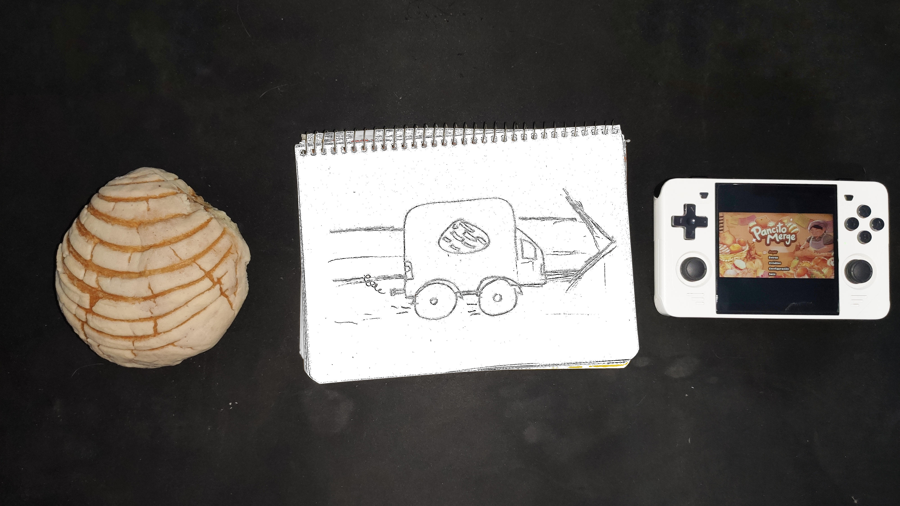

[](https://github.com/blueIronThiever/PancitoMerge-Port/blob/main/README.md)
[](https://github.com/blueIronThiever/PancitoMerge-Port/blob/main/README.en.md)

## Notes

Thanks to Fayer and all the devs involved in the creation of this game: Vanila, inubass, Majo Felix, et.al.

Please support the devs buying Pancito Merge on the official store from [Steam](https://store.steampowered.com/app/3655610/PancitoMerge/)

Warning: Playing this game may induce carving for eating bread.

## Controls

| Button | Action |
|--|--| 
|D-Pad Up / Joystick Up|Up|
|D-Pad Right / Joystick Right|Right|
|D-Pad Down / Joystick Down|Down|
|D-Pad Left / Joystick Left|Left|
|A|Selection / Throw Pancito|
|B|Cancel / Throw Pancito|
|X|Sell Pancito|
|Y|Info|
|Start|Pause|

## Compile

No need to compile

## Instructions

**📦️ Port Installation:**
Please ensure that you have installed the last version of [PortMaster](https://portmaster.games/index.html) on your console

1. Download or clone this repository
2. Upload "Pancito Merge.sh" to your console, on your Ports folder.
On ArkOS / dArkOS the folder is: 
```
/roms/ports/
```
3. Upload the folder "pancitomerge" and their contents on your ports folder


**🕹️ Install the game**
 1. Buy Pancito Merge on Steam
 2. Go to the PCK directory. You normally found it on:
 **Linux:**
 ```bash
home/TuUsuario/.local/share/Steam/steamapps/common/PancitoMerge/PancitoMerge.pck
 ```
 **Windows:**
 ```cmd
 C:\Program Files (x86)\SteamLibrary\steamapps\common\PancitoMerge\PancitoMerge.pck
 ```
 3. Export the pck file to you console on the directory /roms/ports/PancitoMerge/PancitoMerge/
 4. Run and Enjoy!

## 🧪️  Collaboration 

Test the port in your console and report any bug using the bug template into [Issues](https://github.com/blueIronThiever/PancitoMerge-Port/issues) menu

If there is no bug, please make a report with the report template into Issues menu.

I have added a screenshot capture feature into the port. Use it in your reports

The screen capture combo is:

| Button | Action            |
| ------ | ----------------- |
| SELECT | Snapshot |

The snapshot must be in your console, into the following folder:

```
.../ports/pancitomerge/conf/godot/app_userdata/PancitoMerge/
```
